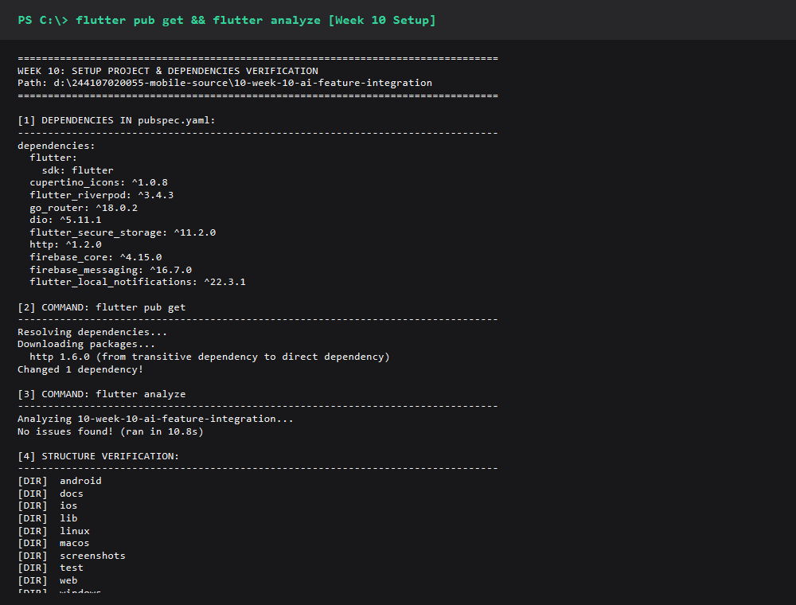

## Jobsheet 10: Integrasi Fitur AI

**Nama:** Nur Alfiyanti <br>
**NIM:** 244107020055 - 17 <br>
**Kelas:** TI-3E <br>

----

## Struktur Project
- `lib/` : kode aplikasi utama (`campus_notify` dengan integrasi fitur AI)
  - `ai/` : service komunikasi ke Gemini AI API (`ai_service.dart`)
  - `core/` : konfigurasi dasar & error handling
  - `data/` : konfigurasi API client & penyimpanan token
  - `features/` : halaman fitur (termasuk `chat_screen.dart`)
  - `messaging/` : implementasi Firebase Cloud Messaging
  - `pages/` & `providers/` : halaman UI dan state management Riverpod
- `test/` : kumpulan unit test dan widget test
- `docs/` : dokumentasi log prompt & output AI (`ai-log.md`)
- `screenshots/` : bukti tangkapan layar pengerjaan & pengujian

## Cara Menjalankan
```bash
flutter pub get
flutter run
```

Untuk menjalankan analisis statis dan seluruh pengujian:
```bash
flutter analyze
flutter test
```

----

## LAPORAN PRAKTIKUM WEEK 10

<details open>
<summary><h3>3. Praktikum: Chat Interface dengan AI</h3></summary>
<br>
<blockquote>

## Langkah 1: Tambahkan Dependensi & Setup Base Project

Proyek dasar `campus_notify` dari minggu sebelumnya disalin ke dalam direktori `10-week-10-ai-feature-integration/`, kemudian ditambahkan dependensi `http` pada `pubspec.yaml` untuk komunikasi REST API ke Gemini AI bersama `flutter_secure_storage` dan `flutter_riverpod`:

```yaml
dependencies:
  flutter:
    sdk: flutter
  flutter_riverpod: ^3.4.3
  flutter_secure_storage: ^11.2.0
  http: ^1.2.0
```

Hasil verifikasi instalasi dependensi (`flutter pub get`), analisis statis (`flutter analyze`), dan struktur folder awal:



*(Sedang dalam proses pengerjaan bertahap — berlanjut ke Langkah 2: Pembuatan `lib/ai/ai_service.dart`...)*

</blockquote>
</details>