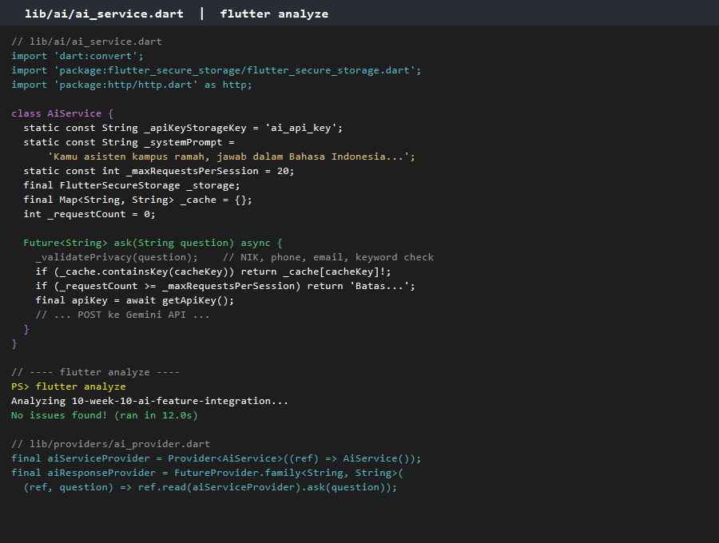
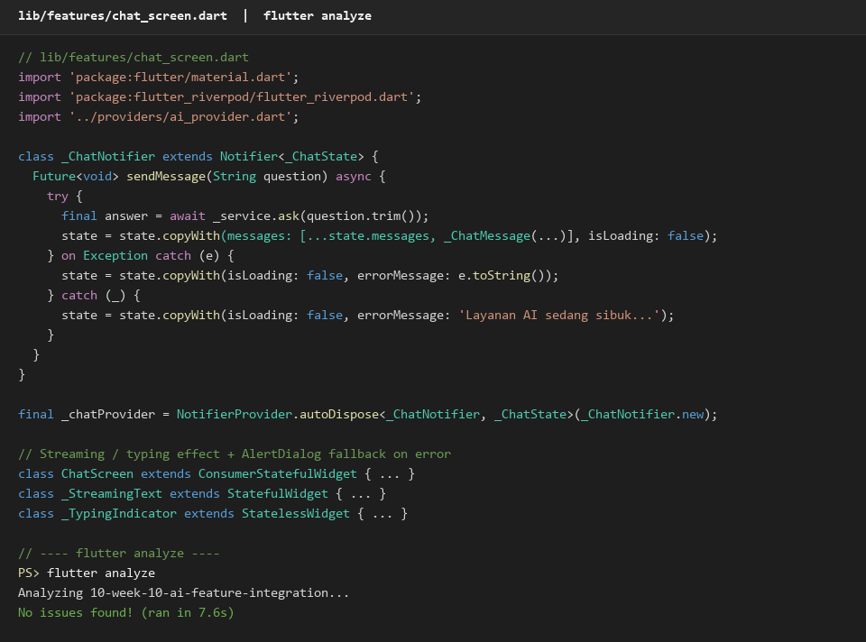
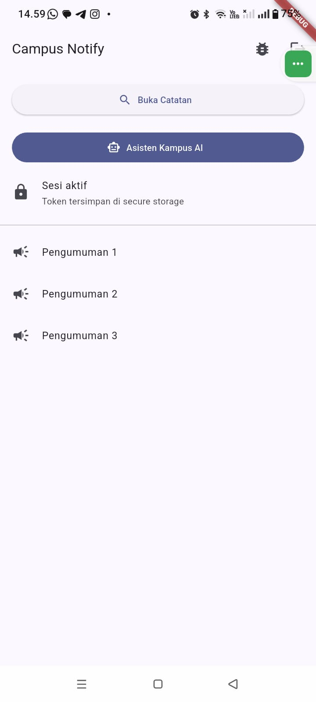
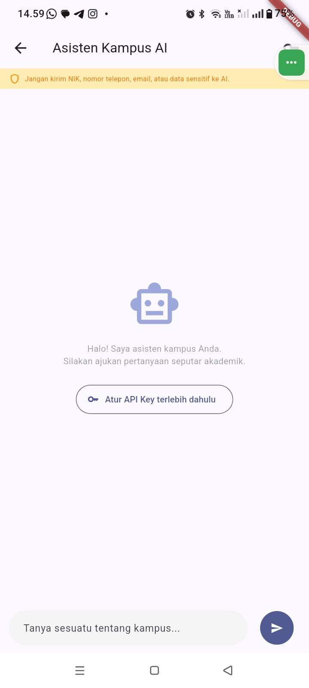

## Jobsheet 10: Integrasi Fitur AI

**Nama:** Nur Alfiyanti <br>
**NIM:** 244107020055 - 17 <br>
**Kelas:** TI-3E <br>

----

## Struktur Project
- `lib/` : kode aplikasi utama (`campus_notify` dengan integrasi fitur AI)
  - `ai/` : service komunikasi ke Gemini AI API (`ai_service.dart`)
  - `core/` : konfigurasi dasar & error handling
  - `data/` : konfigurasi API client & penyimpanan token
  - `features/` : halaman fitur (termasuk `chat_screen.dart`)
  - `messaging/` : implementasi Firebase Cloud Messaging
  - `pages/` & `providers/` : halaman UI dan state management Riverpod
- `test/` : kumpulan unit test dan widget test
- `docs/` : dokumentasi log prompt & output AI (`ai-log.md`)
- `screenshots/` : bukti tangkapan layar pengerjaan & pengujian

## Cara Menjalankan
```bash
flutter pub get
flutter run
```

Untuk menjalankan analisis statis dan seluruh pengujian:
```bash
flutter analyze
flutter test
```

----

## LAPORAN PRAKTIKUM WEEK 10

<details>
<summary><h3>2. Konsep Integrasi Fitur AI</h3></summary>
<br>
<blockquote>

## 1. Apa itu Integrasi Fitur AI?

AI fitur memungkinkan aplikasi mobile berkomunikasi dengan model AI di cloud untuk menyediakan layanan cerdas kepada pengguna:

- **Chat asisten** — pertanyaan jawab dalam waktu nyata dengan LLM API
- **OCR** — ekstraksi teks dari gambar atau dokumen
- **Speech-to-Text** — mengonversi input suara menjadi teks
- **Image Understanding** — caption dan analisis gambar melalui AI
- **Recommendation** — saran personalisasi berdasarkan data pengguna

## 2. Arsitektur Integrasi AI

```
+----------------+   HTTPS/wss   +----------------+
|  Flutter UI    | <-----------> |  AI API Layer  |
| (Chat, OCR,    |  (Dio/http)   | (LLM, OCR,     |
|  STT, Image)   |               |  STT, Vision)  |
+----------------+               +----------------+
        |   API Key (secure storage)       |
        v                                  v Response
+----------------+   Optional    +----------------+
|  Local Cache   | <-----------> |    Backend     |
| (Hive/SQLite)  |  (batching)   | (auth, log)    |
+----------------+               +----------------+
```

- Kunci API tidak pernah disimpan langsung di kode sumber
- Gunakan `flutter_secure_storage` untuk menyimpan token/kunci
- Pertimbangkan biaya per request dan rate limit
- Terapkan cache lokal untuk mengurangi panggilan berulang ke AI API

## 3. Prompt Design untuk Mobile

| Komponen | Contoh | Tujuan |
|---|---|---|
| System prompt | "Kamu asisten kampus ramah, jawab dalam Bahasa Indonesia, maksimal 2 kalimat" | Menetapkan persona dan batas |
| User prompt | "Jadwal kampus hari Senin?" | Input pengguna |
| Konteks | Data jadwal, profil user, lokasi | Membuat respons relevan |
| Batas | Jangan memberikan data pribadi lain | Privasi dan keamanan |

> **Tips:** Pertahankan prompt singkat dan spesifik, terjemahkan hasil jika diperlukan, dan validasi output sebelum ditampilkan ke user.

</blockquote>
</details>

<details open>
<summary><h3>3. Praktikum: Chat Interface dengan AI</h3></summary>
<br>
<blockquote>

## Langkah 1: Tambahkan Dependensi & Setup Base Project

Proyek dasar `campus_notify` dari minggu sebelumnya disalin ke dalam direktori `10-week-10-ai-feature-integration/`, kemudian ditambahkan dependensi `http` pada `pubspec.yaml` untuk komunikasi REST API ke Gemini AI bersama `flutter_secure_storage` dan `flutter_riverpod`:

```yaml
dependencies:
  flutter:
    sdk: flutter
  flutter_riverpod: ^3.4.3
  flutter_secure_storage: ^11.2.0
  http: ^1.2.0
```

Hasil verifikasi instalasi dependensi (`flutter pub get`), analisis statis (`flutter analyze`), dan struktur folder awal:


*(Sedang dalam proses pengerjaan bertahap — berlanjut ke Langkah 2: Pembuatan `lib/ai/ai_service.dart`...)*

## Langkah 2: Buat AI Service

Dibuat file `lib/ai/ai_service.dart` sebagai service utama komunikasi ke Gemini AI API, dan `lib/providers/ai_provider.dart` sebagai Riverpod provider-nya.

### Spesifikasi `AiService`

| Fitur | Implementasi |
|---|---|
| **Secure Storage** | API key dibaca/ditulis via `FlutterSecureStorage` (key: `ai_api_key`), tidak pernah hardcode |
| **System Prompt** | `"Kamu asisten kampus ramah, jawab dalam Bahasa Indonesia, maksimal 2 kalimat."` |
| **Validasi Privasi** | Tolak input yang mengandung NIK 16 digit, nomor telepon `08.../+62...`, email, atau kata kunci `password`/`alamat` |
| **Local Cache** | `Map<String, String>` — pertanyaan yang sama tidak memanggil API ulang |
| **Rate Limiter** | Maks. 20 request per sesi; pesan informatif jika batas tercapai |
| **Fallback Lokal** | Jika API key kosong atau request gagal, kembalikan respons lokal yang informatif |

### Arsitektur `ask()` Flow

```
ask(question)
  ├─ _validatePrivacy()     → Exception jika mengandung data sensitif
  ├─ _cache lookup          → return cache jika tersedia
  ├─ rate limit check       → return pesan batas jika ≥ 20
  ├─ getApiKey()            → return pesan setup jika kosong
  └─ _callGeminiApi()
       ├─ _buildRequestBody()   → system_instruction + contents
       ├─ http.post(Gemini)
       └─ _parseResponse()      → cache & return jawaban
```

```dart
// Contoh penggunaan
final service = AiService();
await service.saveApiKey('YOUR_GEMINI_API_KEY');
final answer = await service.ask('Jadwal kuliah hari ini?');
// → "Jadwal kuliah dapat dilihat di portal akademik kampus."
```

### Riverpod Provider (`lib/providers/ai_provider.dart`)

```dart
final aiServiceProvider = Provider<AiService>((ref) => AiService());

final aiResponseProvider =
    FutureProvider.family<String, String>((ref, question) async {
  final service = ref.read(aiServiceProvider);
  return service.ask(question);
});
```

Hasil `flutter analyze` setelah implementasi:

```
Analyzing 10-week-10-ai-feature-integration...
No issues found! (ran in 12.0s)
```



## Langkah 3: Buat Chat Screen (`lib/features/chat_screen.dart`)

Dibuat halaman chat interaktif pada `lib/features/chat_screen.dart` dengan dukungan **streaming/typing response** dan **indikator loading**, serta diintegrasikan ke navigasi aplikasi (`routes.dart`, `main.dart`, dan `home_page.dart`).

> **Catatan keamanan:** Jangan pernah mengirim NIK, nomor telepon, alamat, atau data sensitif pengguna ke AI API. Gunakan data anonim atau ID internal saja.

### Fitur yang Diimplementasikan
- **State Management (Riverpod 3.x):** Menggunakan `Notifier<_ChatState>` dan `NotifierProvider.autoDispose` untuk mengelola daftar pesan, status loading, dan pesan error.
- **Streaming & Loading UI:** `_StreamingText` menampilkan respons asisten secara bertahap (animasi per 3 karakter) disertai `_TypingIndicator` (`_DotsLoader`) saat menunggu respons API.
- **Banner Keamanan (`_SecurityBanner`):** Pengingat visual di bagian atas layar agar pengguna tidak mengirimkan data sensitif ke AI.
- **Pengaturan API Key (`_showApiKeyDialog`):** Dialog input API key Gemini yang disimpan secara terenkripsi menggunakan `FlutterSecureStorage`.
- **Error Handling & Fallback (`_showErrorDialog`):** Menangkap kegagalan request dan menyediakan opsi **Gunakan Jawaban Offline** langsung ke dalam percakapan.

Hasil `flutter analyze` setelah implementasi `chat_screen.dart`:

```
Analyzing 10-week-10-ai-feature-integration...
No issues found! (ran in 7.6s)
```



</blockquote>
</details>

<details open>
<summary><h3>5. Privasi, Biaya, Error Handling, dan Fallback</h3></summary>
<br>
<blockquote>

### Tabel Risiko dan Mitigasi

| Aspek | Risiko | Mitigasi yang Diterapkan |
|---|---|---|
| **Privasi Data** | Pengguna tidak sengaja mengirim NIK, nomor telepon, email, atau kata kunci sensitif ke AI API eksternal | Validasi lokal `_validatePrivacy()` di `AiService` yang menolak input sensitif sebelum request dikirim + `_SecurityBanner` pada `ChatScreen` |
| **Keamanan API Key** | API key Gemini terekspos di source code atau repositori Git | API key tidak pernah di-hardcode; disimpan terenkripsi per perangkat menggunakan `FlutterSecureStorage` (`ai_api_key`) |
| **Biaya & Kuota Token** | Pemanggilan API berulang untuk pertanyaan yang sama atau spam request | Local cache (`Map<String, String>`) untuk mengembalikan jawaban tersimpan + rate limiter maks. 20 request per sesi |
| **Kegagalan Jaringan / API** | Koneksi terputus, timeout, atau layanan AI mengembalikan status error | Blok `try/catch` pada `_ChatNotifier.sendMessage()` yang menampilkan `AlertDialog` informatif beserta opsi fallback offline |
| **Ketersediaan Layanan** | Layanan AI tidak dapat diakses atau API key belum diatur | Fallback lokal (`addFallback()`) yang memberikan panduan akademik standar agar aplikasi tetap responsif |

### Contoh Implementasi `try/catch` dan `AlertDialog` Fallback

```dart
// State & Notifier (lib/features/chat_screen.dart)
Future<void> sendMessage(String question) async {
  if (question.trim().isEmpty) return;

  state = state.copyWith(
    messages: [
      ...state.messages,
      _ChatMessage(sender: _Sender.user, text: question.trim()),
    ],
    isLoading: true,
    clearError: true,
  );

  try {
    final answer = await _service.ask(question.trim());
    state = state.copyWith(
      messages: [
        ...state.messages,
        _ChatMessage(sender: _Sender.assistant, text: answer),
      ],
      isLoading: false,
    );
  } on Exception catch (e) {
    state = state.copyWith(
      isLoading: false,
      errorMessage: e.toString().replaceFirst('Exception: ', ''),
    );
  } catch (_) {
    state = state.copyWith(
      isLoading: false,
      errorMessage:
          'Layanan AI sedang sibuk. Coba lagi nanti atau gunakan mode offline.',
    );
  }
}
```

```dart
// AlertDialog Fallback pada ChatScreen
void _showErrorDialog(String message) {
  showDialog<void>(
    context: context,
    builder: (ctx) => AlertDialog(
      icon: const Icon(Icons.warning_amber_rounded, color: Colors.orange),
      title: const Text('Layanan AI Sibuk'),
      content: Text(message),
      actions: [
        TextButton(
          onPressed: () {
            Navigator.pop(ctx);
            ref.read(_chatProvider.notifier).clearError();
          },
          child: const Text('Tutup'),
        ),
        FilledButton(
          onPressed: () {
            Navigator.pop(ctx);
            ref.read(_chatProvider.notifier).addFallback();
          },
          child: const Text('Gunakan Jawaban Offline'),
        ),
      ],
    ),
  );
}
```
### Bukti Tampilan Aplikasi (Mobile)

Tombol akses **Asisten Kampus AI** terintegrasi pada halaman utama `Campus Notify`, dan mengarah ke halaman chat lengkap dengan *security banner*, tombol pengaturan API Key, serta kolom input pertanyaan:





</blockquote>
</details>

